# ESPHome-Froeling-Lambdatronic_3200

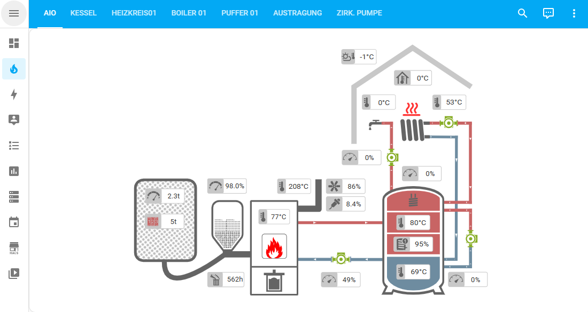
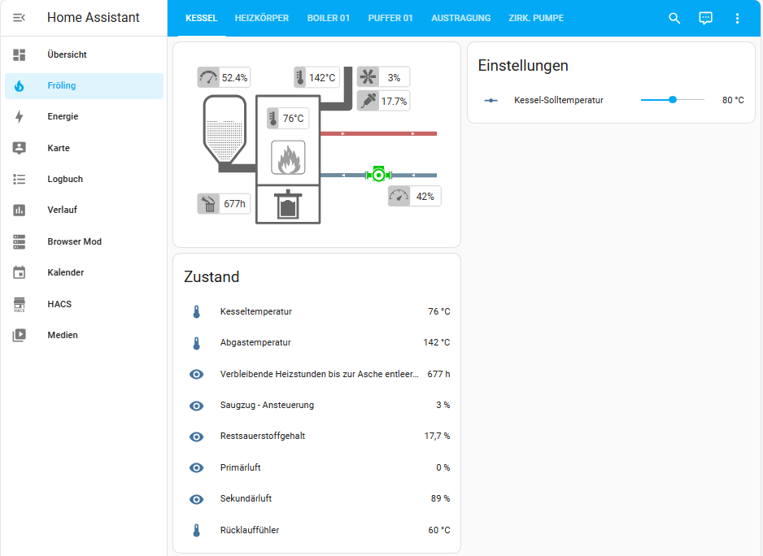
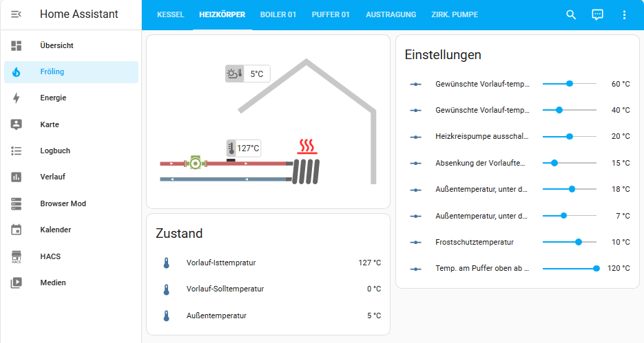
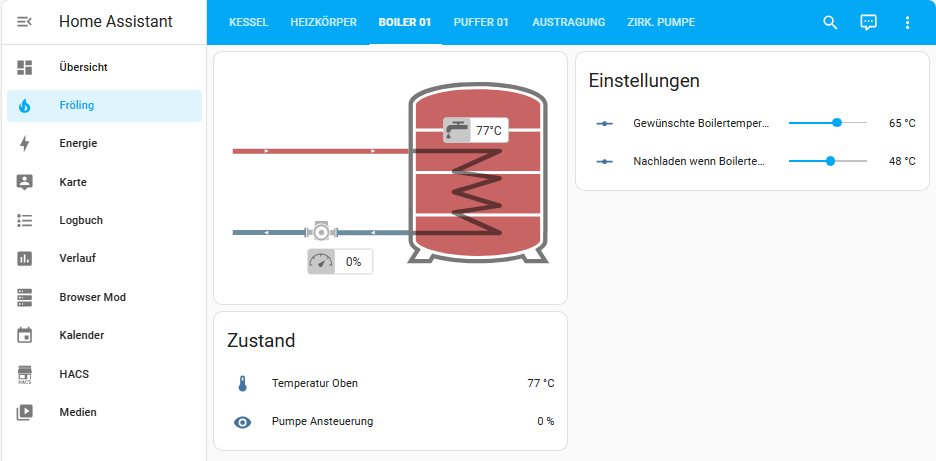
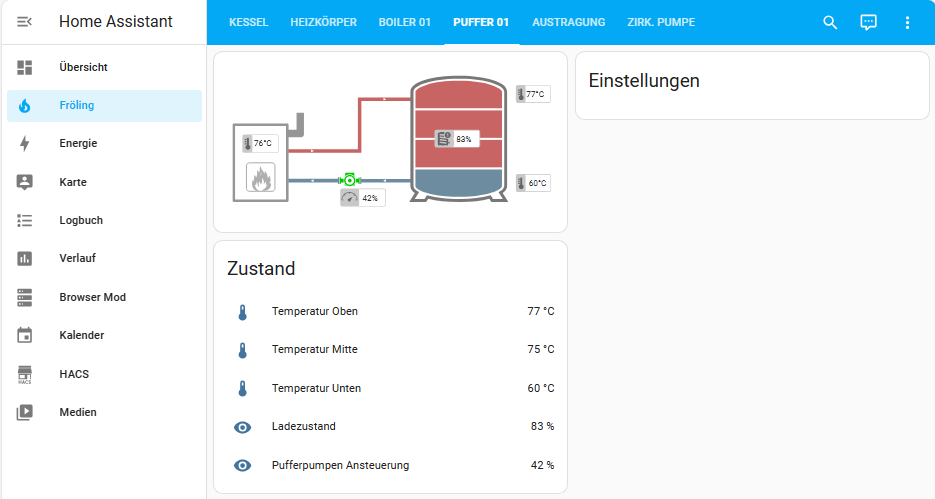
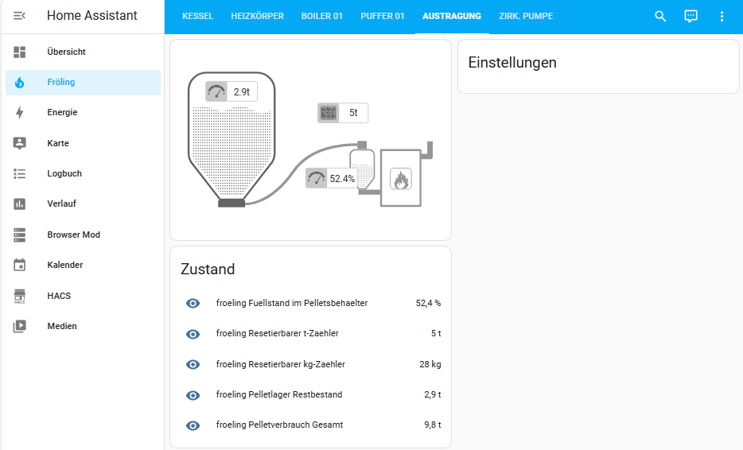
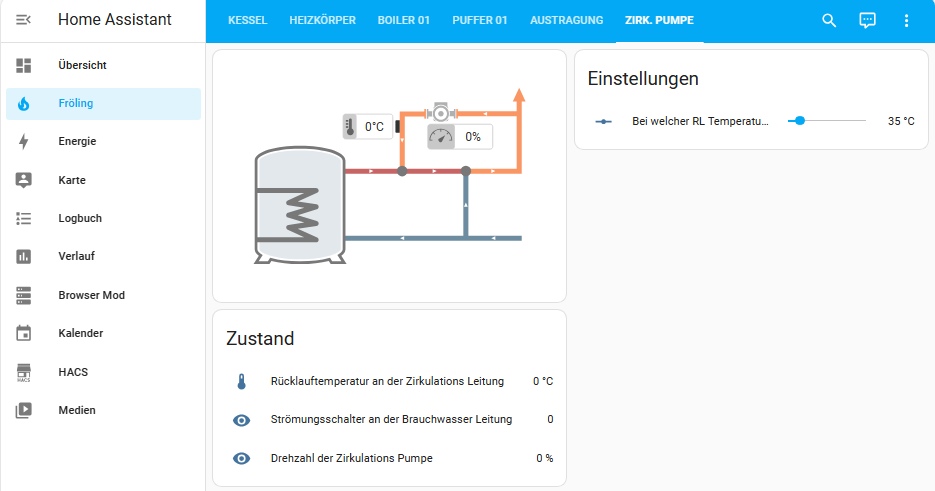
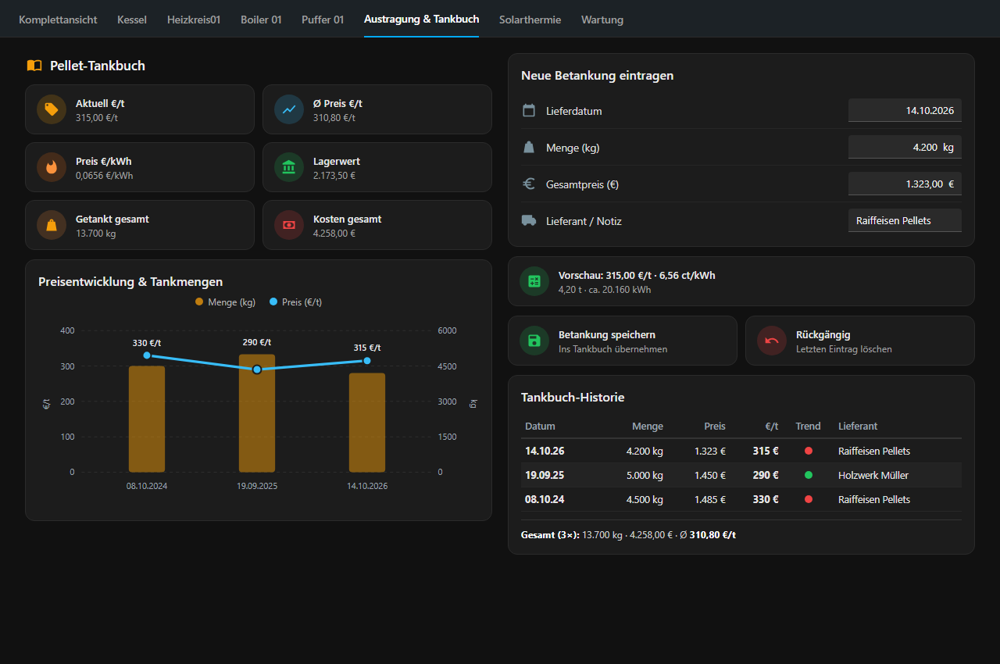
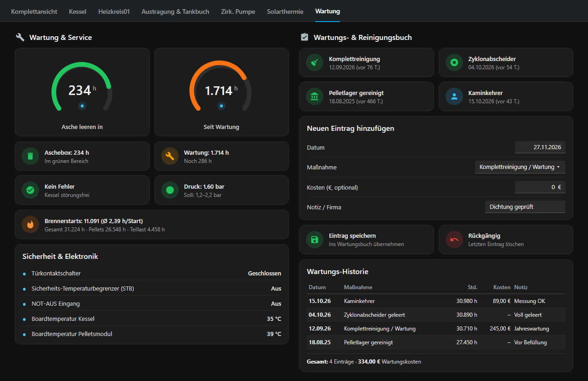

## ESPHome RS232 to TTL - ESP32 - Read & Control Fröling / Lambdatronic 3200

Tested with Fröling **SP Dual 20** and **P4 Pellet** (Lambdatronic 3200, V 50.04 B 05.19). Should also work for other Fröling models equipped with the Lambdatronic 3200 control unit via **COM2 (Modbus RTU)**. Feedback appreciated!  
The official Fröling Modbus communication protocol documentation (V 50.04 B 05.19) is included in this repository (`B1200522_ModBus Lambdatronic 3200_50-04_05-19_de.pdf`).

### Parts

Wemos D1 Mini ESP32:  
<https://www.amazon.de/dp/product/B08BTRQNB3>

MAX3232 DB9 RS232 TTL converter:  
<https://www.amazon.de/gp/product/B0BNQ41QKQ>

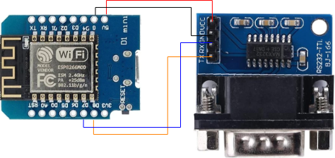

| Wemos | GPIO17 | GPIO16 | GND | 3V3 (3.3V) |
|---|---|---|---|---|
| MAX3232 | TX | RX | GND | VCC |

Connect an RS232 (DB9) cable between the "MAX3232 DB9 RS232 TTL converter" and your boiler's mainboard (**COM2**).

> **Note:** Also works on Ethernet boards such as ESP32-S3-ETH (adjust `esp32:`, `ethernet:`, and `uart:` pins accordingly).

### Boiler Settings

- Click on the user icon
- Enter code `-7`
- `Settings > General Settings > MODBUS Settings > Modbus Protokoll RTU (1)`
- `Settings > General Settings > MODBUS Settings > use Modbus Protokoll 2014 -> yes`
- `Settings > General Settings > MODBUS Settings > Use COM2 as MODBUS Interface -> yes`

### ESPHome

> **Minimum ESPHome version:** `2026.10.0` (tested with `2026.11.1`, uses `turnaround_time` and parameterized `packages` with `vars`).

The configuration is modularized into individual remote package YAML files so you only include the components installed on your heating system.  
Just flash `froeling.yaml` to your ESP32 (edit `api`, `ota`, `wifi`, and remove/comment out unused files).

```yaml
packages:
  remote_package:
    url: https://github.com/GyroGearl00se/ESPHome-Froeling-Lambdatronic_3200
    ref: main
    refresh: 1d
    files:
      - kessel.yaml
      - austragung.yaml
      - boiler_01.yaml
      - puffer_01.yaml
      - zirkulationspumpe.yaml
      - solarthermie.yaml
      - fehlerpuffer.yaml
      # - path: drucksensor.yaml # Optional analog pressure sensor (see pin notes in drucksensor.yaml)
      #   vars:
      #     drucksensor_pin: GPIO34
      - path: heizkreise.yaml
        vars:
          hk: 1
      - path: heizkreise.yaml
        vars:
          hk: 2
      # Additional heating circuits (HK3 to HK18):
      # - path: heizkreise.yaml
      #   vars:
      #     hk: 3
```

#### Available Modules

| File | Description |
|---|---|
| `froeling.yaml` | Main configuration (ESP32, UART/Modbus RTU, outside temp, system & boiler states) |
| `kessel.yaml` | Boiler sensors, board temp, burner starts, operating hours (pellet/wood/part-load), state runtimes, SP Dual auto-ignition & pellet delay switches/numbers, status & fault helpers |
| `heizkreise.yaml` | **Generic heating circuit package for HK1–HK18** via `vars: { hk: 1..18 }` incl. operating mode `select` (Aus/Automatik/Extraheizen/Absenken/Dauerabsenken/Party + FRA alias handling) |
| `heizkreis01.yaml` / `heizkreis02.yaml` | Legacy packages for HK1/HK2 (kept for backwards compatibility) |
| `austragung.yaml` | Pellet bunker/hopper levels, total & resettable counters (kg & kWh), disable automatic feeding switch, minimum stock warning threshold |
| `boiler_01.yaml` | DHW tank temperatures (incl. solar reference), pump & target temperature settings |
| `puffer_01.yaml` | Buffer tank temperatures, charge level & buffer pump |
| `solarthermie.yaml` | Solar collector temperatures, pump, flow (`L/h`), daily & total yield (kWh) |
| `zirkulationspumpe.yaml` | Circulation pump return temperature, flow switch & speed |
| `fehlerpuffer.yaml` | Discrete safety inputs (door switch, STB, emergency stop, boiler release) + 5-register error buffer & active-fault binary sensor |
| `drucksensor.yaml` | Optional analog heating pressure sensor (ADC) with configurable `drucksensor_pin` (use ADC1 pins only; avoid GPIO16/17 on Wemos D1 Mini ESP32) |

### Home Assistant Dashboard & Optional Logbooks

- Dedicated Lovelace cards: <https://github.com/GyroGearl00se/lovelace-froeling-card>
- Classic Floorplan dashboard & SVGs: `ha_dashboard.yaml` and `ha_dashboard/`

#### Optional Home Assistant Packages (Pellet Logbook & Maintenance Logbook)

This repository includes two restart-safe Home Assistant packages that require no external database:

1. **`ha_dashboard/froeling_pellet_tankbuch.yaml` – Pellet Refill Logbook (`Pellet-Tankbuch`)**
   - Tracks every pellet delivery (date, kg, total price, supplier/note) with undo support
   - Automatically calculates current price (`€/t` and `€/kWh`), weighted average price (`€/t`), total delivered kg, total costs (`€`), and current silo stock value (`€`)
   - Automatically records the last counter reset date when the resettable pellet counter drops back to `0`
2. **`ha_dashboard/froeling_wartungsbuch.yaml` – Maintenance & Cleaning Logbook (`Wartungs- & Reinigungsbuch`)**
   - Tracks full cleaning/maintenance, cyclone separator emptying, pellet storage cleaning, chimney sweep, ash box emptying, and repairs
   - Automatically snapshots the current boiler operating hours (`sensor.froeling_betriebsstunden`) with each entry and tracks total maintenance costs (`€`)
   - Provides dedicated "last performed" sensors (date & days ago) for dashboard traffic-light badges

##### Installation in Home Assistant

1. **Enable Packages** in your `/config/configuration.yaml` (if not already present):
   ```yaml
   homeassistant:
     packages: !include_dir_named packages
   ```
2. **Copy the desired file(s)** from `ha_dashboard/` into `/config/packages/`:
   - `/config/packages/froeling_pellet_tankbuch.yaml`
   - `/config/packages/froeling_wartungsbuch.yaml`
   *(Note: Check the `entity_id` in the reset automation inside `froeling_pellet_tankbuch.yaml` and adjust it if your ESPHome device name differs from `froeling`.)*
3. **Restart Home Assistant** once so all `input_*` helpers, `script.*`, and `template` sensors are created.
4. **Optional HACS Frontend Cards** for the modern dashboard views shown above:
   - `Mushroom Cards` (`lovelace-mushroom`)
   - `ApexCharts Card` (`apexcharts-card`) – for the pellet price & quantity chart
   - `Modern Circular Gauge` (`modern-circular-gauge`) – for the ash & maintenance gauges
   - `card-mod` – for styled history tables

### Home Assistant Energy Dashboard (Pellet Consumption & Cost Tracking)

You can track your pellet heating consumption and costs directly inside the official **Home Assistant Energy Dashboard** under **Gas** (in `kWh`):

1. Open **Settings → Dashboards → Energy**.
2. Under **Gas consumption**, click **Add gas source**.
3. Select the total pellet energy sensor **`sensor.froeling_pelletverbrauch_gesamt_kwh`** (unit: `kWh`, `device_class: energy`, `state_class: total_increasing`).
4. *(Optional, requires `froeling_pellet_tankbuch.yaml`)* Select **"Use an entity with current price"** and choose **`sensor.froling_pelletpreis_aktuell_eur_kwh`** (`€/kWh`). Home Assistant will automatically calculate your daily, monthly, and yearly pellet heating costs based on your actual purchase prices!

#### Calorific Value (Energy Content / Heizwert)

All `kWh` and `€/kWh` calculations in `austragung.yaml` and `ha_dashboard/froeling_pellet_tankbuch.yaml` use a calorific value of:

- **`4.8 kWh/kg`** (`4,800 kWh/t`) – standard average for **ENplus A1 wood pellets** (typical range: `4.6–5.0 kWh/kg`).

If your pellet supplier specifies a different energy content (e.g. `4.9 kWh/kg`), simply adjust the factor `4.8` in `austragung.yaml` (`Pelletverbrauch Gesamt (kWh)`) and `ha_dashboard/froeling_pellet_tankbuch.yaml` (`ct_kwh`).

### 3D Printed Case

I've designed a housing for a Wemos ESP32 & RS232 Adapter. The front section is a bit fragile – but other than that, it works quite well. At the bottom, you'll find round inlays where you could fit in some 3x10mm magnets to attach the case easily to the housing of your heating unit.

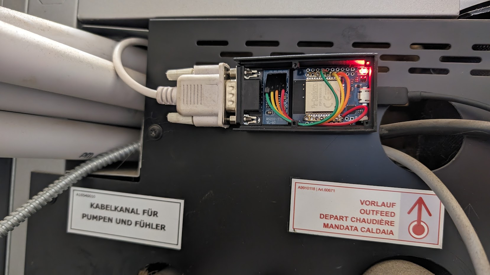
(Picture without lid to give you a better idea)


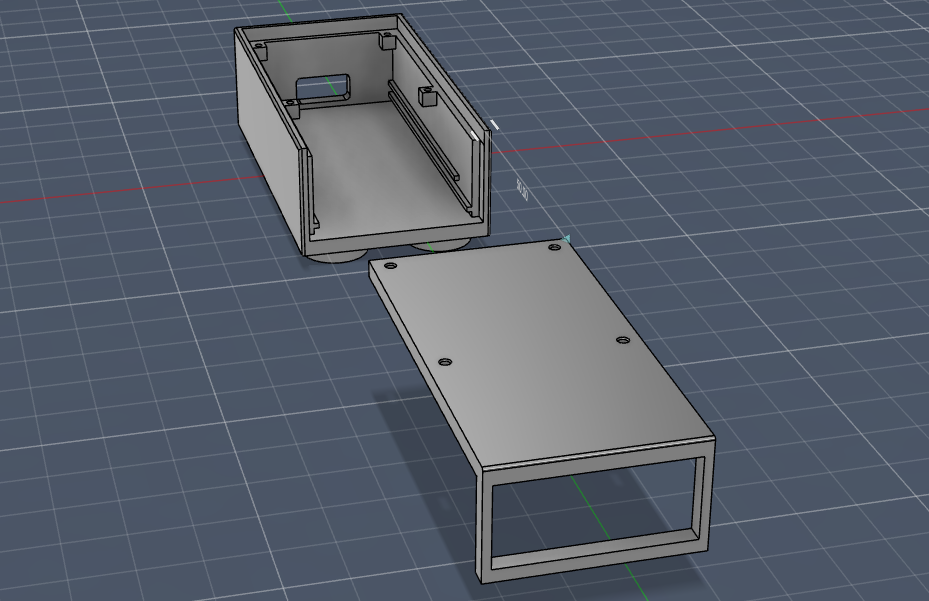
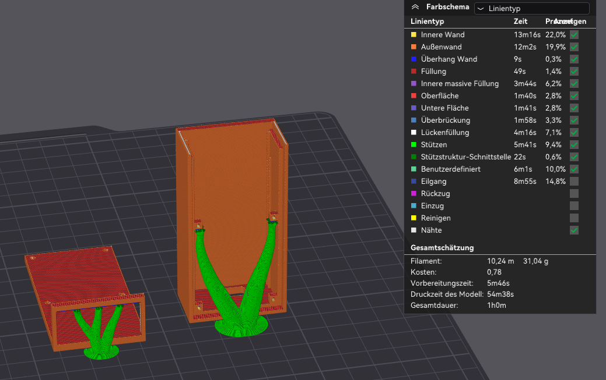

### Changelog

#### v2.0 (2026-11-27)
- **ESPHome 2026.10+ / 2026.11 compatibility:** Replaced deprecated `command_throttle` with `turnaround_time: 50ms`, added `refresh: 1d` and parameterized `packages` syntax in `froeling.yaml`.
- **Generic Heating Circuits (`heizkreise.yaml`):** Supports **HK1–HK18** via `vars: { hk: <1..18> }` including operating mode `select` (with FRA alias mapping for values `6`/`11`/`12`) and exact overheat protection register mapping. Legacy `heizkreis01.yaml` & `heizkreis02.yaml` updated and kept for backwards compatibility.
- **Expanded Boiler & SP Dual Support (`kessel.yaml`):** Added board temperature, calculated target temperature, boiler control output, burner starts, operating hours (pellet/heating/part-load/log wood), current & max state runtime, `Automatisch Zünden` switch, log-wood pellet delay number, boiler demand, fault binary sensor, and status group text sensor. Verified Saugzug (`address: 13`) vs. Sekundärluft (`address: 12`) live on hardware.
- **Error Buffer & Safety Inputs (`fehlerpuffer.yaml`):** Added discrete inputs (door contact, STB, emergency stop, boiler release) and single-request 5-register error buffer.
- **Pellet Feeding & Energy Dashboard (`austragung.yaml`):** Added resettable total (`kg`), total energy (`kWh` at `4.8 kWh/kg` for the HA Energy Dashboard under Gas), disable automatic feeding switch, and minimum stock threshold.
- **Fixes & Improvements across Modules:** Fixed `S_WORD` signed value types for negative temperatures, removed incorrect `0.5` step on integer (`DEZ = 0`) temperature registers, fixed `solarthermie.yaml` flow unit (`l/h` → `L/h`) + total kWh template sensor, added `Boiler 1 Temperatur Solarreferenz` (`boiler_01.yaml`), and added `state_class` for Home Assistant long-term statistics.
- **Optional Analog Pressure Sensor (`drucksensor.yaml`):** Added modular ADC pressure sensor with configurable `drucksensor_pin` variable and board-specific ADC1 pin notes.
- **Home Assistant Logbook Packages:** Added `ha_dashboard/froeling_pellet_tankbuch.yaml` (Pellet Refill Logbook + Energy Dashboard price sensor) and `ha_dashboard/froeling_wartungsbuch.yaml` (Maintenance & Cleaning Logbook) with screenshots and installation guide.

#### v1.0 (Initial Release)
- Initial ESPHome Modbus RTU (COM2) modular configuration for Fröling Lambdatronic 3200 (`froeling.yaml`, `kessel.yaml`, `austragung.yaml`, `boiler_01.yaml`, `heizkreis01.yaml`, `heizkreis02.yaml`, `puffer_01.yaml`, `solarthermie.yaml`, `zirkulationspumpe.yaml`).
- Home Assistant SVG Floorplan dashboard (`ha_dashboard.yaml`) and 3D-printed Wemos + MAX3232 magnetic case.

### Contribution

Wrong/Missing data? Feel free to create an issue, join a discussion, or fork this repository and create a pull request with your fix.
